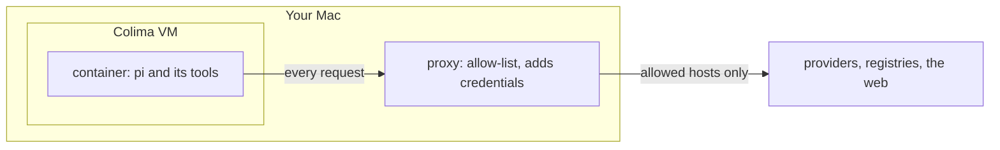

# pinata

Run the pi coding agent on your Mac as you always do, with the agent kept in a sandbox.

Part of [pinata](../README.md).

## What it does

Pinata installs itself as `pi`. You keep typing `cd <folder> && pi`, and your providers, MCP servers, settings, packages and skills work as before, with the exceptions listed under [What is different inside the sandbox](#what-is-different-inside-the-sandbox) (a symlinked skill, for one, stays out).

Pi runs in a Linux container inside a small virtual machine (Colima). The container sees the [workspace root](CONFIGURATION.md#workspace-root), the folder that holds your projects, and nothing else of your home.

The container never holds your real keys. Its only way out is a proxy on your Mac. The proxy lets through only the hosts on an allow-list, and adds your credentials on the way out.



## Install

You need pi on the host, macOS 13 or newer, [Homebrew](https://brew.sh) when Colima is missing, Node 22.19 or newer with npm, and git. Colima 0.9.0 or newer is installed with Homebrew when it is missing.

```bash
npm install -g --legacy-peer-deps @zharskiy/pinata@<version>
pinata install [--config <file>] [--yes]
```

Pinata never installs, updates or removes pi. Without a host pi, `pinata install` and `pinata update` stop before they change anything and say so; install pi with pi's own installer (`curl -fsSL https://pi.dev/install.sh | sh`) or with `npm install -g @earendil-works/pi-coding-agent`, then run the command again. Pinata runs pi's managed install in `~/.pi/agent` on the host (for provider credentials, host commands and `--no-sandbox`), or, without one, the pi in npm's global packages (`npm root -g`). A pi found only on `PATH` or in a project's `node_modules` is not used, nor an npm global pi linked in from outside npm's global folder (`npm link`), or one that lies in a folder a sandbox has run in, or in the folder you start pi in (or its git root) when a sandbox could run there. A git checkout no sandbox has used, such as `/opt/homebrew` or `~/.nvm`, does not count.

`pinata install` refuses to run as root and while pi sessions run in the sandbox VM, and runs only from npm's global copy of the package or from a checkout. It then:

1. Registers the package with host pi as `npm:@zharskiy/pinata@<version>`, the version you installed, so pi loads the extensions of that version; `pi update --extensions` does not move a pinned source.
2. Links `~/.local/bin/pi` to pinata, after checking it before step 1, so a refusal changes nothing. pi's managed link there is replaced, and `pinata uninstall` puts it back, as is the wrapper an earlier install wrote; any other file stops the install.
3. Puts `~/.local/bin` first on `PATH` with a marked block in `~/.zshrc`, and in `~/.bashrc` and `~/.bash_profile` when they exist. A file with an unpaired or repeated marker line is left as it is, with a line saying so. `pinata uninstall` cuts the block with the newline it added, so the file is as it was.
4. With `--config <file>`, writes that file over `~/.pi/agent/pinata/config.json`, after checking it before anything else changes. It writes it on every install that passes it, with no merge: this is how a team hands out one config.
5. Runs `pinata init`, which asks which folder holds your projects, shows the VM size it picked for this Mac, and creates the VM when you choose Apply. It asks only on a first install (no `workspaceRoot` in the config) at a terminal, without `--yes`, `--config` or `CI`; otherwise it runs as `pinata init --yes`, and not at all when the config has a `workspaceRoot`, the VM exists and no `--config` was given.

Run again, `pinata install` changes nothing. Open a new terminal afterwards.

To pick other versions, run `pinata update [<version>]`: it runs `npm install -g --legacy-peer-deps @zharskiy/pinata@<version>` (`latest` without a version), then the new copy's `pinata install --yes`. A bare `pi update` moves an npm pi to the latest version. Pi in the sandbox follows the host pi.

To change the folder or the VM size later, run `pinata init` again. It plans the same VM shares as a launch, the folders of `mounts.binds` included.

### Set up the sandbox

`pinata init` sets up the sandbox in three short steps, then shows a review: the project folder, the VM size and the settings write-back. Nothing is saved until you choose Apply. A first run looks like this (in plain mode; a normal terminal draws the same as a menu you move through with the arrow keys):

```
pinata setup
This Mac: 12 CPUs, 32 GiB memory, 412 GiB free disk
Sandbox VM: not created yet
Nothing is saved until you choose Apply.

Which folder holds your projects?   step 1 of 3
  1) ~/Projects (14 git repositories)
  2) ~/work (3 git repositories, you are here)
  3) ~/src (no git repository found)
  4) Another folder...
Choose [2]:

VM size   step 2 of 3
  1) Automatic (8 CPUs, 10 GiB memory, 60 GiB disk)
  2) Custom...
Choose [1]:

Copy settings changed in the sandbox back to your pi?   step 3 of 3 (Y/n):

Review
  Project folder: ~/work (chosen)
  VM size: 8 CPUs, 10 GiB memory, 60 GiB disk (automatic)
  Settings write-back: on (default)
  1) Apply
  ...
Saved ~/.pi/agent/pinata/config.json
Created the VM in 54s: 8 CPUs, 10 GiB memory, 60 GiB disk
Done. The sandbox is ready.
```

- **Project folder.** One folder that holds your projects. The list holds the usual project folders of your home (`~/Projects`, `~/Developer`, `~/code` and the like) and the top folder of where you are, with the number of git repositories in each; the folder of the config or of `PINATA_ROOT` comes first, else the one you are in, else the first with repositories. Another folder... lets you type any other path. Your home, or a folder that holds it, is refused (`~ is your home or holds it, and the sandbox VM must not see all of it.`), and so is a folder that does not exist. Pi starts only inside this folder, and the VM shares only it (writable), pi's session folder `~/.pi/agent/sessions` (writable) and pinata's `state/vm` folder (read-only, the rendered files). A folder elsewhere, such as `/Volumes/Projects`, works too.
- **VM size.** Automatic follows this Mac: its CPU count from 2 to 8, half its memory from 4 to 10 GiB, and a 60 GiB disk. Custom asks for each value; the disk can only grow.
- **Settings write-back.** On by default: preference changes made inside the sandbox are copied to your pi on this Mac (see [Settings written back](CONFIGURATION.md#settings-written-back)).

Run again, `pinata init` opens the review with your current settings; a config without `workspaceRoot` (written by hand, or from before the key existed) asks the three steps again first. It writes only `workspaceRoot`, `vm.cpus`, `vm.memoryGiB`, `vm.diskGiB` and `writeBack.enabled` in `~/.pi/agent/pinata/config.json`, and keeps every other key, their order, the line endings and a symlinked file's link; the file is re-indented to its own first indent, and a key written twice keeps its last value. The review shows the re-indent before you apply. Apply creates the VM, or restarts it with the new size or folder when no pi session runs; while sessions run, it keeps the VM as it is and the first pi you start after they all exit restarts it. Before Apply, ctrl-c or Cancel writes nothing and exits with status 130. During the VM step after Apply the config is already saved: ctrl-c twice stops waiting (also exit 130) while colima goes on, and running `pinata init` again, or the next pi start, finishes the VM step.

`PINATA_PLAIN=1` asks the same questions as numbered lines that you answer by typing, with no menu to move through, no spinner and no colour: for screen readers and plain terminals. A dumb or unset `TERM` gets plain mode too, read line by line without any cursor control (and so without Tab completion of paths).

Without a terminal (CI, a provisioning script), `pinata init` refuses, and `pinata init --yes` asks nothing: it keeps the settings in the file and applies them to the VM, printing the same lines as the plain setup: the review of the settings, the file changes and the VM action first, then the progress and the result. `pinata install` uses `--yes` when it finds no terminal or `CI` is set. To name the project folder there, set `PINATA_ROOT`, which `--yes` writes to a config without `workspaceRoot`; with neither, `--yes` refuses and writes nothing:

```bash
PINATA_ROOT="$HOME/Projects" pinata install
```

A config whose `workspaceRoot` names another folder stops `--yes` (a trailing `/` and `~` against the full path do not matter), and so does a `PINATA_ROOT` that is your home or holds it. So does a config with any invalid key: `--yes` prints the error like every other command, writes nothing and exits 1, and never fixes a value for you. When colima does not answer in time, `--yes` saves the config, says the VM could not be checked and exits 0; the next pi start applies the size and the shares. For the VM size, set `vm` in the config first (see [VM size](CONFIGURATION.md#vm-size)). See [Workspace root](CONFIGURATION.md#workspace-root).

<details>
<summary>Install from a checkout</summary>

```bash
git clone https://github.com/zharskiy/pinata.git
cd pinata
npm install
node launcher/bin/pinata-dev.js install
```

The `pi` link then runs this checkout's sources, `~/.local/bin/pinata` links to `launcher/bin/pinata-dev.js` so `pinata` runs them too (any other file there stops the install), and pi registers the checkout folder as the package's source. `pinata update` refuses in a checkout: `git pull`, then install again.

</details>

## Quick start

1. Start pi in a project:

   ```bash
   cd ~/code/my-app && pi
   ```

   The first launch builds the sandbox image, which takes a few minutes. Behind a proxy that inspects TLS it fails until [`tls.extraCa`](CONFIGURATION.md#corporate-proxy-and-tls-inspection) names the proxy's CA, which `pinata doctor` prints. When the image must be rebuilt, for example after a pi update, the launch prints `preparing the sandbox, one time` and takes a few minutes.

2. Work as usual. A tool that reaches a host that is not allowed gets an error page saying what to do.

3. Exit pi. Pinata names each host it blocked:

   ```
   pinata: docs.example.com was blocked in the sandbox; run pinata egress allow docs.example.com on the host
   ```

4. To let pi reach that host, allow it. The grant applies to every session, at once, also to running ones.

   ```console
   $ pinata egress allow docs.example.com
   allowed docs.example.com
   ```

5. If something does not work, run `pinata doctor`. It shows by area (host, sandbox, network, credentials) one line per thing that works, such as `vm`, `sandbox`, `isolation`, `tls` and `secrets`, and each check that warns or fails under its own name, with the reasons and a `hint:` under it; it lists the launch notices at the end and closes with one `result:` line that names the checks that failed or warned. The credential rules that pass share one line, `logins` when each is a pi login, else `credential hosts`; a rule from your `credentials.rules` that fails or warns shows its rule id. `--verbose` lists every check with its detail, the credential rules with their ids and the leak sweep in its own area. The leak sweep does not check `env.set` values that match the config and names the secret-looking ones it skipped, so it does not catch a secret written into `env.set`. A glab host you never logged in to gets no notice while another glab host has a token.

## Everyday use

In the table, *host pi* is pi's managed install on your Mac, or without one the pi in npm's global packages. A *grant* is a host you allowed. *Overlay* and *agent* volumes are storage the VM keeps for the folder's build output and pi's own files.

| command | what it does |
| --- | --- |
| `pi [args...]` | run pi in the sandbox for this repository; pi's exit code is pinata's |
| `pi --no-sandbox [args...]` | run host pi, outside the sandbox |
| `pi install\|remove <source>` | with host pi on the host (-l passes through into the sandbox) |
| `pi mcp add\|remove\|login\|logout ...` | with host pi on the host |
| `pi auth ...` | with host pi on the host, against the logins the proxy uses |
| `pi [command] --help` | pi's help, with host pi on the host |
| `pi --list-models [search]` | with host pi on the host |
| `pi --export <file> [out]` | with host pi on the host |
| `pi --version` | the pi version the sandbox runs, without starting a sandbox |
| `pi update [target]` | update host pi, its packages or its model catalogs, with host pi on the host |
| `pi config` | the user resource config, with host pi on the host (-l passes through into the sandbox) |
| `pinata install [--config <file>] [--yes]` | set up pinata's package in host pi, the pi link, PATH and the sandbox VM; needs pi installed on the host, --config writes that file as the config, --yes asks nothing |
| `pinata update [<version>]` | install that pinata version with npm (latest without one), then its pinata install --yes |
| `pinata uninstall [--sandbox]` | remove the sandbox VM, pinata's state, its links, its PATH block and its package in host pi; your config, sessions, pi and colima stay; --sandbox removes only the sandbox VM, the pi link and pinata's state, so pi runs host pi |
| `pinata init [--yes]` | set up or change the folder that holds your projects, VM size and settings write-back, then apply them to the sandbox VM; --yes asks nothing and applies the current settings |
| `pinata status` | runtime, services, container, proxy, image, launches, grants, overlays, volumes |
| `pinata list` | the sandbox VM and the pi sessions it runs, for every folder, without starting it |
| `pinata config [--json]` | the effective config and whether each key comes from the config file or the default |
| `pinata egress allow <host[:port]>` | allow a host for every session until revoked |
| `pinata egress revoke <host[:port]>` | remove a grant |
| `pinata egress list [--denied]` | the grants, or the hosts the proxy blocked |
| `pinata restart` | remove the sandbox's containers, volumes and images and restart the VM, once no pi session runs; the next pi rebuilds them, and it asks first when service data or sandbox sessions would go |
| `pinata stop` | stop the services and the sandbox VM when no pi session runs |
| `pinata doctor [--verbose]` | prepare the sandbox like pi and report what needs attention by area, with a hint per problem; --verbose lists every check with its detail |
| `pinata --version`, `pinata help` | version and usage |

`pi uninstall <source>` also runs with host pi on the host. Host pi loads no extension for `pi --help` and `pi --list-models`, so help omits the flags extensions register and the list omits providers only an extension registers; `pi list`, `pi mcp list` and `pi config -l` run in the sandbox, and `pi --version` asks pi inside when `image.reference` and `image.digest` pin the image. `egress allow` uses port 443 unless you name one, and refuses wildcards, IP addresses and port 80 ([rules](CONFIGURATION.md#network-access)).

`pi update` runs the host pi's own update from an empty folder, and the next launch rebuilds the image. A local path as the source (`./ext`, `~/ext`) is made absolute against your folder first. Every other `pi update` form (`--all`, `--extensions`, `--extension <source>`, `<source>`, `--models`, `--force`) runs host pi from an empty folder, so it updates the host's packages and the host pi, never a copy inside the sandbox; when the target includes pi itself it names the pi version the sandbox follows. Without a host pi it says how to get one. To update pinata itself, run `pinata update [<version>]` (or `git pull` and `pinata install` in a checkout).

After a reboot or `pinata stop`, the next `pi` starts the VM again. A failure prints `pinata: <message>`, often with a `hint:` line.

## What is different inside the sandbox

- **Log in on the host.** Provider `/login` does not work inside. Run `pi auth login <provider>`, or `pi --no-sandbox`, then `/login`.
- **Packages and MCP servers change on the host.** The sandbox picks up `pi install` and `pi mcp add` at its next launch. Npm and git packages inside follow the versions installed on your Mac: after `pi update` (or any other change on the host) the next launch says `sandbox packages follow the host: reinstalling <n> packages` and pi inside installs those versions. An npm source without a version or with a range or tag (`npm:x`, `npm:x@^1`, `npm:x@latest`) is pinned to the host's version; an exact pin, an alias (`npm:x@npm:other@2`) and a git, URL or file spec stay as you wrote them. A git source is pinned to the host checkout's commit only when that commit is on the remote (a remote branch or tag); with local commits or after an upstream force-push it stays unpinned, and a `#ref` source is never pinned. When another pi session of this install is running, git checkouts are not refreshed and the launch says `sandbox packages follow the host: git packages refresh at the next launch (another session is running)`. A launch that finds the install's record of package versions missing or unreadable, the install's first launch for one, clones every git package again. The reinstall needs the registry or git host in `egress.allow`; without it pi reports the package as failed to install instead of running an old copy. Before pi starts, pinata installs the extensions missing from the shared pi folder (and npm packages whose host version changed), one session at a time: it prints `pinata: installing <n> extensions in the shared pi folder; this can take a few minutes`, and for each one that still fails `pinata: warning: <source> could not be installed in the shared pi folder (<reason>); pi tries again when it starts`. A later launch does not start an install for that one again while it stays missing, and says `pinata: warning: <source> could not be installed in the shared pi folder last time, so pinata did not try again; pi tries when it starts`; `pinata restart` forgets it. Pi starts either way. It is skipped when pi in the sandbox is offline (`PI_OFFLINE` in `env.set`, or `--offline`). The packages of a project's `.pi/settings.json` are not installed this way; pi installs them into that project's `.pi/` when it starts, and a running pi still installs on `/reload` or `pi install`.
- **Skills come as copies, and links stay out.** The sandbox gets a copy of `~/.pi/agent/skills` and of `~/.agents/skills` (and of the agents, prompts, themes and extensions in `~/.pi/agent`), refreshed at every launch, without secret-looking files, files over 8 MiB and private keys. The copy follows no symlink: a linked skill dir or file, or a linked `~/.agents/skills`, is missing inside, and the first launch that finds it names it (`render: missing in the sandbox, because pinata follows no symlinks: …`). Make it a real directory to carry it. One link needs nothing: a skill dir directly in `~/.pi/agent/skills` that links to a skill dir directly in `~/.agents/skills`, as `npx skills add` makes, when `~/.agents/skills` is a real directory. That skill arrives through `~/.agents/skills`. Every other link is named, a nested one or one inside `~/.agents/skills` included. The line is printed once per folder for the same set of links, so a skill still missing later says nothing more.
- **Resource paths in `settings.json` are rewritten.** An `extensions`, `skills`, `prompts` or `themes` entry inside the repository becomes its absolute path, one anywhere inside `~/.pi/agent` (pi's package checkouts under `git/` and `npm/` included) or `~/.agents/skills` points at the same path inside the sandbox, and any other path is left out with a line naming it. Relative patterns (`!old-*`, `-skills/x`) and `builtin:` entries stay as written.
- **No Docker.** `docker compose` and Testcontainers do not work. Declare a database in [`services`](CONFIGURATION.md#services), or [run one inside](CONFIGURATION.md#databases-and-other-services).
- **Only https leaves, and your Mac's `localhost` is out of reach.** Servers you start inside answer on `127.0.0.1`.
- **Java goes through the proxy.** `~/.m2/settings.xml` points Maven at `pinata-proxy:3128`, with no credentials, and every JDK in the image has the proxy in its `net.properties`. A JDK installed later needs `trust-jdk.sh` ([a JDK in a volume](CONFIGURATION.md#a-jdk-in-a-volume)).
- **Home lives in memory.** `/home/pi` and `/tmp` are emptied when pi exits. Pi's own files survive in one agent volume that every folder's sandbox shares, so pi's package installs, its in-sandbox settings and, with `sessions.host` off, its sessions are the same whichever folder you start in. `pinata restart` removes it once no pi session runs, and asks first while `sessions.host` is off. To keep a tool cache or other data, list its folder in `mounts.volumes`.
- **Build output has its own copy.** `node_modules`, `.venv`, `target` and `.gradle` get their own volume when a matching lockfile sits beside them ([list](CONFIGURATION.md#build-output-overlays)). Run your install command, such as `npm install`, once inside.
- **Large builds keep your Mac's open files in check.** The VM holds one file open on your Mac for each file it has cached from your folders. While pi runs, pinata drops that cache when the count nears your Mac's limit, so a build over a very large tree does not run your Mac out of file descriptors ([File cache](CONFIGURATION.md#file-cache)).
- **Leftovers of older builds go away on their own.** Once a day pinata removes the stopped containers, unused volumes and free networks that an older pinata build left in the VM: named `pinata-*`, marked as pinata's own, and without the install label it sets now. A running one stays until it stops, and the engine keeps a volume or network still in use. Shared volumes (`pinata-shared-*`) are never removed this way. An older build's agent volume holds the pi settings that build kept inside the sandbox, and they go with it. The per-folder agent volumes and render folders of launchers before the shared pi folder go on their own only once their folder no longer exists: the daily pass removes such an unused agent volume (with `sessions.host` off, the sessions kept in it go with it) and forgetting the folder removes its render folder. Until then `pinata status` lists them as `leftover:` lines, and `pinata restart` removes them. Files in pinata's default state folder (not one `PINATA_STATE_DIR` names) that this build does not use go too, once they are a day old; running an older build after a newer one removes the newer build's files the same way.
- **Sessions are shared.** `/resume` on your Mac lists sandbox sessions.
- **Copy reaches your Mac's clipboard.** What pi copies inside (OSC 52) is also put on the macOS clipboard with `pbcopy`, so it works in terminals that ignore OSC 52. The output still reaches your terminal unchanged.
- **Pasted screenshots work.** Dragging or pasting the path of a PNG, JPEG, GIF or WebP file (up to 20 MiB) that the sandbox cannot see copies it to `/tmp/pi-paste/` inside and pastes that path instead. If the file cannot be read (macOS blocks the terminal from Desktop or Downloads until you allow it under System Settings → Privacy & Security → Files and Folders) or is not there, the path is pasted as it is and your terminal shows a notification saying why. That needs a terminal that shows OSC 9 notifications: iTerm2 does, with "Send escape sequence-generated alerts" on in the profile; terminals without OSC 9 support, Terminal.app among them, show nothing.
- **Ctrl+V pastes a copied image.** With a PNG on the clipboard (a screenshot copied with Cmd+Ctrl+Shift+4, say), Ctrl+V copies it to `/tmp/pi-paste/` inside and pastes its path. A single image file copied in Finder is copied in the same way; with text, several files or another file, Ctrl+V reaches pi as it is.

All three are on a Mac only; `terminal.clipboard: false` turns them off.
- **Some settings come back to your Mac.** When you change the default model, provider or thinking level, the enabled models, the theme or a few display and queue preferences inside (in `settings.json`), or the settings of the subagents, style, notifications and session-limits extensions and the prune interval (their `pi-*.json` files; the prune interval only as one of the values `/prune` offers or off), pinata copies the change to your Mac when pi exits, or at the next launch after a crash, and prints one line per change. A value of the wrong type, or a theme name that is not a plain file name, is not copied and a line says so; if a settings file is missing from the sandbox, nothing in it is removed on your Mac. If you changed the same setting on your Mac meanwhile, your Mac's value wins and a line says so. `writeBack` in the config can take keys off this list, add plain preferences or turn it off ([Settings written back](CONFIGURATION.md#settings-written-back)). Nothing else comes back, whatever the config says: packages, extensions, skills, commands, paths, proxy settings, logins, `models.json`, `mcp.json` and agent files change only on your Mac.
- **A new share restarts the VM once.** The VM shares only the workspace root, so the restart happens when the root changes; a stopped VM starts with the new shares directly. If other pi sessions run, also from another agent dir, a launch whose folder the VM does not share yet stops and asks you to exit them first; when the current shares already cover the launch, it goes ahead and says the VM changes at the next launch with no other pi session running.

### Where pi can start

Pi starts in a repository or in a plain folder, anywhere inside the [workspace root](CONFIGURATION.md#workspace-root), and not at all while it is unset. Wherever it starts, the sandbox sees the whole root, read-write. A repository whose git data lies outside the root is refused, since git would not work inside. In a plain folder outside git, build output is not overlaid and a line says so. Pi does not start in your home folder, `/`, system folders or credential folders such as `~/.ssh`.

If your home folder is a git repository, pi starts under it only inside a repository of its own.

All checks are in [baseline guarantees](THREAT-MODEL.md#3-baseline-guarantees), under "Workspace guard" and "Git dirs inside the root".

## What it protects and what it does not

It protects:

- **Your files.** Pi sees the workspace root, every project in it and their git data. The rest of your home, `~/.ssh` and `~/.pi` stay hidden.
- **Your secrets.** Every key inside is a *placeholder*, a stand-in value. The proxy swaps it for the real one, only toward the host it belongs to.
- **Your network.** Only listed hosts are reachable. Private and loopback addresses are refused. The sandbox has no address of the VM to reach, and the proxy token stays outside it: only the sandbox's relay holds it.

It does not protect:

- **Use of your credentials.** The agent cannot read them, but can use them: push with your glab token, call your provider, publish a package.
- **The workspace root.** The agent can change any file of any project in it: `.git/hooks`, `.git/config`, other projects' `node_modules`, and the pi extensions and packages there that pi on your Mac runs. Nothing is reported when pi exits. Keep only your own projects in the root.
- **Data sent to allowed hosts.** Anything can leave through them.
- **Earlier sessions.** Host pi's sessions of this folder are readable inside, with any secret a tool printed in them. `sessions.host: false` keeps them apart.
- **Your clipboard.** The agent can put text there for you to paste somewhere else, an image on it enters the sandbox when you press Ctrl+V, and an image whose path you paste is copied in. `terminal.clipboard: false` turns these off.
- **The rest of the VM.** The Colima VM can read and write the whole [workspace root](CONFIGURATION.md#workspace-root), not only the folder pi started in; only the container is limited. Besides it, the VM sees pi's session folder, a read-only pinata folder and the folders of read-only binds.

The full list is in [known gaps](THREAT-MODEL.md#5-known-gaps).

## Configuration

Your settings go in `~/.pi/agent/pinata/config.json` (inside pi's agent folder, so under `PI_CODING_AGENT_DIR` when you set it). This one file is the whole configuration, for every folder you start pi in: it belongs to you, and a team can share a copy of it as is. There are no profiles, and nothing in the project folder configures the sandbox ([what follows from that](CONFIGURATION.md#one-config-for-every-session)). Removed keys and defaults, and what to do when you update pinata, are in [REMOVED-DEFAULTS.md](REMOVED-DEFAULTS.md). A Java developer might use:

```json
{
  "egress": { "allow": ["registry.npmjs.org", "repo1.maven.org", "plugins.gradle.org", "registry.corp.example"] },
  "image": { "packages": ["openjdk-17-jdk-headless", "maven"] }
}
```

- `egress.allow`: the hosts the sandbox may reach besides `pi.dev` and your providers. It is empty by default, so package registries such as `registry.npmjs.org` are reachable only once you list them or allow them with `pinata egress allow`.
- `image.packages` and `image.npmGlobal`: Debian and npm packages to add to the image. The image has no GitHub CLI; [REMOVED-DEFAULTS.md](REMOVED-DEFAULTS.md#the-github-cli) shows how to add `gh` and its token. Pinata's CA and your `tls.extraCa` CAs are built into the image's system store and into every JDK the image holds (its `cacerts`, and its `net.properties` points Java at the sandbox proxy), so the image is rebuilt when a CA changes.
- `mounts.volumes`: folders such as `~/.npm` or `/opt/data`, kept in volumes that every session shares, in any folder. Your Mac's own folder is not mounted. A cache such as `~/.m2/repository` may sit beside a file pinata puts there (`~/.m2/settings.xml`, which points Maven at the sandbox proxy).
- `mounts.binds`: files or folders of your Mac mounted read-only inside, such as `{ "source": "~/reference", "target": "/etc/reference" }`. A source outside the folders the VM shares adds a read-only share, which restarts the VM once.
- `setup`: commands run inside before pi starts, at every launch, such as `[["npm", "ci"]]`. A failing command stops the launch. See [Setup commands](CONFIGURATION.md#setup-commands) before you add one.
- `services`: long-running processes such as a database, in containers of their own next to pi, reached on `localhost:<port>` for each port you declare. Every pi session of one pinata state folder (one per agent dir by default) shares one set of them and their data; they start with the first session and stop when the last one ends. See [Services](CONFIGURATION.md#services) for what follows from that.
- `vm`: the CPUs, memory and disk of the VM, applied at the next launch with no other pi session running, or at once by `pinata init` when none runs. `resources` limits one container inside the VM instead: CPUs, memory, processes (`pids`, 4096 by default), open files and the size of `/dev/shm`.
- `env.set`: variables with a fixed value in every sandbox process, such as `{ "CI": "1" }`. Names pinata sets are refused. The agent sees every value, so no secrets.
- `writeBack`: which settings changed inside come back to your Mac, inside limits pinata keeps.

Inside, `PINATA_STATUS` names a JSON file that tells the agent what the sandbox gives it: the proxy, the limits, volumes, binds, setup and services ([Sandbox status file](CONFIGURATION.md#sandbox-status-file)). [Recipes](CONFIGURATION.md#recipes) show common combinations, such as seeding a volume, git SSH remotes and a JDK in a volume.

`pinata config` shows the result. Every key, credentials and corporate proxies are in [CONFIGURATION.md](CONFIGURATION.md), and [examples/config.json](examples/config.json) is a starting point for a team's shared file.

## Troubleshooting

Start with `pinata doctor`, which names the failing check.

| symptom | what to do |
| --- | --- |
| A host `was blocked in the sandbox` | Follow the hint in that line. `pinata doctor` puts the same hint under the check of a credential host the proxy refused (named for its login, such as `<provider> login`, or for its host), for example the address a host resolved to and the `egress.privateHosts` entry that allows it, and reports any other host blocked during its run as a `blocked <host:port>` warning. |
| The doctor's `trust` check or a credential host's check fails with `CERT_NOT_YET_VALID` | The VM's clock is more than an hour behind the host's. Run `pinata stop` once no pi session runs, then `pinata doctor` again, which starts the VM afresh. |
| A provider login is missing or expired | Run `pi --no-sandbox`, then `/login`. |
| Pi says `the sandbox VM does not exist` | Run `pinata init`, which creates the VM with its size, shares and VM type. A bare `colima start` would create it with colima's defaults instead. |
| Pi says `the sandbox VM engine is unreachable` | Run `pi`, which starts the VM with its planned shares, when the profile exists, else `pinata init`. A bare `colima start` would share your home folder. |
| The VM is running but its engine does not answer | Run `pinata stop`, then `pi` again. |
| A folder is not shared with the VM | Exit your other pi sessions and run `pi` again. |
| Pi says `config: workspaceRoot: <root> does not exist` | Create the folder, mount the volume it lives on, or run `pinata init` to choose another. `pi --no-sandbox` needs no `workspaceRoot`, but refuses one that does not exist. |
| Pi says `config: workspaceRoots is not a known key` | The key is now `workspaceRoot`, one folder: replace it by hand, or remove it and run `pinata init`. |
| An HTTP 502 about a certificate | Run `pinata doctor` and add the `{ "sha256": … }` line it prints to [`tls.extraCa`](CONFIGURATION.md#corporate-proxy-and-tls-inspection). |
| `unable to get local issuer certificate` or `self-signed certificate in certificate chain` while installing dependencies | Your network inspects TLS. Run `pinata doctor`: its `tls inspection` check names the CA that signs pi.dev and prints the `{ "sha256": … }` line for [`tls.extraCa`](CONFIGURATION.md#corporate-proxy-and-tls-inspection), or, when that CA is in no macOS keychain, the issuer to ask your IT for, to add as `{ "file": … }`. |
| A launch prints `preparing the sandbox, one time` and takes minutes | That launch builds the image, which carries the sandbox CAs; it is built again only when what it is built from changes: the base image and then the layer, or only the layer when `image.digest` pins the base. Later launches reuse it. |
| A command `is not in the sandbox image` | Add it to `image.packages` or `image.npmGlobal`. |
| `sudo`, `doas` or `systemctl` says `there is no root in the sandbox` | Add packages to `image.packages`, which installs them as root when the image is built, and list a server the agent needs under `services`, which runs it in a container of its own, see [Services](CONFIGURATION.md#services). |
| Perl or another program prints `Setting locale failed` | `env.allow` lists `LANG` and the image lacks that locale. Drop `LANG` to keep the image's `C.UTF-8`, or generate the locale with `image.dockerfile`, see [Variables passed into the sandbox](CONFIGURATION.md#variables-passed-into-the-sandbox). |
| The npm registry lacks your host pi version | Install a published pi version on your Mac. |
| A large build fails with `Too many open files in system` | Your Mac ran out of open files for the VM's cached files. Check the `file cache` line of `pinata doctor --verbose` and [File cache](CONFIGURATION.md#file-cache). Until then, `pinata stop` once no pi session runs frees them all, or raise the limit until the next reboot with `sudo sysctl -w kern.maxfiles=524288 kern.maxfilesperproc=262144`. |
| A running session missed a config change | See [when changes apply](CONFIGURATION.md#when-changes-apply). |

## Uninstall

Exit every pi session, then run `pinata uninstall`. It releases the sandbox, deletes the `pinata` Colima profile with its containers, volumes and images, removes the `pi` link (and puts pi's managed link back if the install replaced it), the `pinata` link of a checkout install, the package's source in pi, the `PATH` blocks, pinata's state (`~/.pi/agent/pinata/state`) and the npm package.

Your repositories, `~/.pi` with its sessions, your config `~/.pi/agent/pinata/config.json` and pi stay; pinata never removes pi.

To run pi on the host again without removing pinata, run `pinata uninstall --sandbox`. It does the same, except that pinata's extensions stay in host pi, and the `PATH` block and the `pinata` command stay too. `pi` is then host pi, and `pinata install` brings the sandbox back. Colima stays installed. Remove it with `brew uninstall colima` if nothing else uses it. `pinata list` shows this sandbox VM; `colima list` shows every Colima VM on the Mac.

## More

How it works and every file it writes: [ARCHITECTURE.md](ARCHITECTURE.md). Where the code is: [STRUCTURE.md](STRUCTURE.md).

To work on pinata, run `npm run check` from the repository root. `node launcher/bin/pi-dev.js` runs a checkout. `PINATA_LIVE=1 npm run test:live` tests against real Colima.
