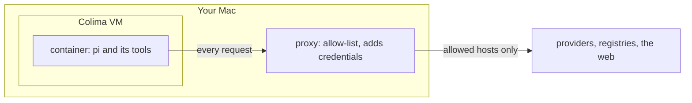

# pi-sandbox

Run the pi coding agent on your Mac as you always do, with the agent kept in a sandbox.

Part of [pi-extensions](../README.md).

## What it does

`pi-sandbox` installs itself as `pi`. You keep typing `cd <folder> && pi`, and your providers, MCP servers, settings, packages and skills work as before.

Pi now runs in a Linux container inside a small virtual machine (Colima). The container sees the repository, or plain folder, you started pi in, and nothing else of your home.

The container never holds your real keys. Its only way out is a proxy on your Mac. The proxy lets through only the hosts on an allow-list, and adds your credentials on the way out.



## Install

You need:

- macOS 13 or newer.
- [Homebrew](https://brew.sh).
- Colima 0.8.0 or newer. The script installs it with Homebrew if it is missing.
- Node 22.19 or newer, with npm.
- git.
- pi, installed with pi's own installer. The launcher runs only this managed install on the host (for provider credentials, host commands and `--no-sandbox`); a pi installed with npm or found on `PATH` is not used.

```bash
curl -fsSL https://pi.dev/install.sh | sh
npm install -g --omit=peer pi-extensions-mz
"$(npm root -g)/pi-extensions-mz/launcher/install.sh"
```

Without the managed install, `install.sh` stops before it changes anything and says to install pi this way and run it again.

The script starts a Colima profile named `pi-sandbox` and puts `~/.local/bin` first on `PATH` in your shell startup files. Open a new terminal afterwards.

If `~/.local/bin/pi` is pi's own managed install, the script replaces that link. An earlier pi-sandbox link or wrapper is replaced too. Any other file there stops the install.

The VM gets this Mac's CPU count, from 2 to 8, and half its memory, from 4 to 10 GiB, with a 60 GiB disk. To change that, pass `--cpu N`, `--memory GiB` or `--disk GiB` to `install.sh`. To resize the VM later, while no pi runs:

```bash
colima stop --profile pi-sandbox && colima start --profile pi-sandbox --activate=false --cpu 4 --memory 8
```

<details>
<summary>Install from a checkout</summary>

```bash
curl -fsSL https://pi.dev/install.sh | sh
git clone https://github.com/zharskiy/pi-extensions.git
cd pi-extensions
npm install
launcher/install.sh
```

Pi's own installer comes first here too: the launcher runs only pi's managed install on the host, never the pi in the checkout's `node_modules` or a pi on `PATH`. The script writes a wrapper script at `~/.local/bin/pi` that runs this checkout. Without the managed install, the launch, `pi sandbox doctor`, `--no-sandbox` and the host commands say so in one line, with the same remedy.

</details>

## Quick start

1. Start pi in a project:

   ```bash
   cd ~/code/my-app && pi
   ```

   The install script already built the sandbox image, so pi starts in seconds. When the image must be rebuilt, for example after a pi update, the launch prints `preparing pi sandbox, one time` and takes a few minutes.

2. Work as usual. A tool that reaches a host that is not allowed gets an error page saying what to do.

3. Exit pi. The launcher names each host it blocked:

   ```
   pi-sandbox: docs.example.com was blocked in this folder's sandbox; run pi sandbox egress allow docs.example.com on the host from /Users/you/code/my-app
   ```

4. To let pi reach that host, allow it. This applies at once, also to running sessions. Add `--user` to allow it for every folder.

   ```console
   $ pi sandbox egress allow docs.example.com
   allowed docs.example.com for /Users/you/code/my-app
   ```

5. If something does not work, run `pi sandbox doctor`. It reports each check by area (host, sandbox, network, credentials, leak sweep), puts the reasons and a `hint:` under each problem, lists the launch notices at the end and closes with one `result:` line. The credential rules that pass share one line; `--verbose` lists each.

## Everyday use

In the table, *host pi* is pi's managed install on your Mac. A *grant* is a host you allowed. *Overlay* and *agent* volumes are storage the VM keeps for the folder's build output and pi's own files.

| command | what it does |
| --- | --- |
| `pi [args...]` | run pi in the sandbox for this repository; pi's exit code is the launcher's |
| `pi --no-sandbox [args...]` | run host pi, outside the sandbox |
| `pi install\|remove <source>` | with host pi on the host (-l passes through into the sandbox) |
| `pi mcp add\|remove\|login\|logout ...` | with host pi on the host |
| `pi auth ...` | with host pi on the host, against the logins the proxy uses |
| `pi [command] --help` | pi's help, with host pi on the host |
| `pi --list-models [search]` | with host pi on the host |
| `pi --export <file> [out]` | with host pi on the host |
| `pi --version` | the pi version the sandbox runs, without starting a sandbox |
| `pi update [target]` | update host pi, its packages or its model catalogs, with host pi on the host |
| `pi config` | the user resource config, with host pi on the host (-l passes through into the sandbox) |
| `pi sandbox status` | runtime, container, proxy, image, launches, grants, overlays, shared caches |
| `pi sandbox config [--json]` | the effective config and whether each key comes from the config file or the default |
| `pi sandbox egress allow <host[:port]> [--user]` | allow a host for this repository, or with --user for every repository, until revoked |
| `pi sandbox egress revoke <host[:port]> [--user]` | remove a grant |
| `pi sandbox egress list [--denied]` | grants with their scope, or the hosts the proxy blocked |
| `pi sandbox reset` | remove this folder's sandbox with its overlay and agent volumes once none of its sessions runs |
| `pi sandbox stop` | stop the sandbox VM when no pi session runs |
| `pi sandbox doctor [--verbose]` | prepare the sandbox like pi and report each check by area, with a hint per problem; --verbose lists every credential rule |
| `pi sandbox --version`, `pi sandbox help` | version and usage |

`pi uninstall <source>` also runs with host pi on the host. Host pi loads no extension for `pi --help` and `pi --list-models`, so help omits the flags extensions register and the list omits providers only an extension registers; `pi list`, `pi mcp list` and `pi config -l` run in the sandbox, and `pi --version` asks pi inside when `image.reference` and `image.digest` pin the image. `egress allow` uses port 443 unless you name one, and refuses wildcards, IP addresses and port 80 ([rules](CONFIGURATION.md#network-access)).

`pi update` runs the managed install's own update from an empty folder, and the next launch rebuilds the image. A local path as the source (`./ext`, `~/ext`) is made absolute against your folder first. Every other `pi update` form (`--all`, `--extensions`, `--extension <source>`, `<source>`, `--models`, `--force`) runs host pi from an empty folder, so it updates the host's packages and the host pi, never a copy inside the sandbox; when the target includes pi itself it names the pi version the sandbox follows. Without a managed install it says how to get one. To update the launcher itself, run `npm install -g --omit=peer pi-extensions-mz` (or `git pull` in a checkout).

After a reboot or `pi sandbox stop`, the next `pi` starts the VM again. A failure prints `pi-sandbox: <message>`, often with a `hint:` line.

## What is different inside the sandbox

- **Log in on the host.** Provider `/login` does not work inside. Run `pi auth login <provider>`, or `pi --no-sandbox`, then `/login`.
- **Packages and MCP servers change on the host.** The sandbox picks up `pi install` and `pi mcp add` at its next launch.
- **No Docker.** `docker compose` and Testcontainers do not work. You can [run a database inside](CONFIGURATION.md#databases-and-other-services).
- **Only https leaves, and your Mac's `localhost` is out of reach.** Servers you start inside answer on `127.0.0.1`.
- **Home lives in memory.** `/home/pi` and `/tmp` are emptied when pi exits. Pi's own files survive in the folder's agent volume. To keep a tool cache, list it in `mounts.sharedCaches`.
- **Build output has its own copy.** `node_modules`, `.venv`, `target` and `.gradle` get their own volume when a matching lockfile sits beside them ([list](CONFIGURATION.md#build-output-overlays)). Run your install command, such as `npm install`, once inside.
- **A small image.** It has git, ripgrep, fd and pi, but no curl, python3, gh or glab. [REMOVED-DEFAULTS.md](REMOVED-DEFAULTS.md) lists what earlier versions shipped and how to add it back.
- **Sessions are shared.** `/resume` on your Mac lists sandbox sessions.
- **A folder outside your home restarts the VM** at its first launch. If other pi sessions run, the launch stops and asks you to exit them first.

### Where pi can start

Pi starts in a repository or in a plain folder. A folder with several repositories is checked repository by repository. Bare repositories in it are read-only: clone and fetch work, push does not.

Pi does not start in your home folder, `/`, system folders or credential folders such as `~/.ssh`. It refuses git files that git did not write. A plain folder is refused when it holds over 128 repositories or 50,000 directories.

If your home folder is a git repository, pi starts under it only inside a repository of its own.

All checks are in [baseline guarantees](THREAT-MODEL.md#3-baseline-guarantees), under "Workspace guard" and "Workspace mode".

## What it protects and what it does not

It protects:

- **Your files.** Pi sees the repository or plain folder, and its git data. The rest of your home, `~/.ssh` and `~/.pi` stay hidden.
- **Your secrets.** Every key inside is a *placeholder*, a stand-in value. The proxy swaps it for the real one, only toward the host it belongs to.
- **Your network.** Only listed hosts are reachable. Private and loopback addresses are refused.
- **Your git hooks.** `.git/hooks` is read-only inside.

It does not protect:

- **Use of your credentials.** The agent cannot read them, but can use them: push with your gh token, call your provider, publish a package.
- **The folder.** The agent can change any file in it, `.git/config` included. When pi exits, the launcher names changed git files. Review them before you run git there.
- **Data sent to allowed hosts.** Anything can leave through them.
- **Earlier sessions.** Host pi's sessions of this folder are readable inside, with any secret a tool printed in them. `sessions.host: false` keeps them apart.
- **The rest of the VM.** The Colima VM can read and write your whole home. Only the container is limited.

The full list is in [known gaps](THREAT-MODEL.md#5-known-gaps).

## Configuration

Your settings go in `~/.pi/agent/pi-sandbox/config.json` (inside pi's agent folder, so under `PI_CODING_AGENT_DIR` when you set it). An older `~/.config/pi-sandbox/config.json` is no longer read; the launch tells you to move it. This one file is the whole configuration: it belongs to you, and a team can share a copy of it as is. Nothing in the project folder configures the sandbox. A Java developer might use:

```json
{
  "egress": { "allow": ["registry.npmjs.org", "repo1.maven.org", "plugins.gradle.org", "registry.corp.example"] },
  "image": { "packages": ["openjdk-17-jdk-headless", "maven"] }
}
```

- `egress.allow`: the hosts the sandbox may reach besides `pi.dev` and your providers. It is empty by default, so package registries such as `registry.npmjs.org` are reachable only once you list them or allow them with `pi sandbox egress allow`.
- `image.packages` and `image.npmGlobal`: Debian and npm packages to add to the image.
- `mounts.sharedCaches`: cache folders such as `~/.npm`, kept in volumes that all your sandboxes share. Your Mac's own folder is not mounted.

`pi sandbox config` shows the result. Every key, credentials and corporate proxies are in [CONFIGURATION.md](CONFIGURATION.md), and [examples/config.json](examples/config.json) is a starting point for a team's shared file.

## Troubleshooting

Start with `pi sandbox doctor`, which names the failing check.

| symptom | what to do |
| --- | --- |
| A host `was blocked in this folder's sandbox` | Follow the hint in that line. `pi sandbox doctor` puts the same hint under the `rule` check of a credential host the proxy refused, for example the address a host resolved to and the `egress.privateHosts` entry that allows it, and reports any other host blocked during its run as a `blocked <host:port>` warning. |
| The doctor's `trust` or `rule` check fails with `CERT_NOT_YET_VALID` | The VM's clock is behind the host's. Run `pi sandbox stop` once no pi session runs, then `pi sandbox doctor` again, which starts the VM afresh. |
| A provider login is missing or expired | Run `pi --no-sandbox`, then `/login`. |
| Pi says `the sandbox VM engine is unreachable` | Run `colima start --profile pi-sandbox --activate=false`, or `install.sh` if the profile is gone. |
| The VM is running but its engine does not answer | Run `colima stop --profile pi-sandbox && colima start --profile pi-sandbox --activate=false`. |
| A folder is not shared with the VM | Exit your other pi sessions and run `pi` again. |
| An HTTP 502 about a certificate | Add your network's CA with [`tls.extraCa`](CONFIGURATION.md#corporate-proxy-and-tls-inspection). |
| A command `is not in the sandbox image` | Add it to `image.packages` or `image.npmGlobal`. |
| The npm registry lacks your host pi version | Install a published pi version on your Mac. |
| A running session missed a config change | See [when changes apply](CONFIGURATION.md#when-changes-apply). |

## Uninstall

Exit every pi session, then run the script from where you installed:

```bash
"$(npm root -g)/pi-extensions-mz/launcher/uninstall.sh"   # npm install
launcher/uninstall.sh                                     # checkout
```

It deletes the `pi-sandbox` Colima profile, the launcher's state (`~/.pi/agent/pi-sandbox/state`), the `pi` link, the npm package and the `PATH` lines. It restores pi's managed link if `install.sh` replaced it.

It also deletes the old state folder `~/.local/state/pi-sandbox` if an earlier version left one. Your repositories, `~/.pi` with its sessions, and your config `~/.pi/agent/pi-sandbox/config.json` stay. Colima stays installed. Remove it with `brew uninstall colima` if nothing else uses it.

## More

How it works and every file it writes: [ARCHITECTURE.md](ARCHITECTURE.md). Where the code is: [STRUCTURE.md](STRUCTURE.md).

To work on the launcher, run `npm run check` from the repository root. `node launcher/bin/pi-sandbox-dev.js` runs a checkout. `PI_SANDBOX_LIVE=1 npm run test:live` tests against real Colima.
